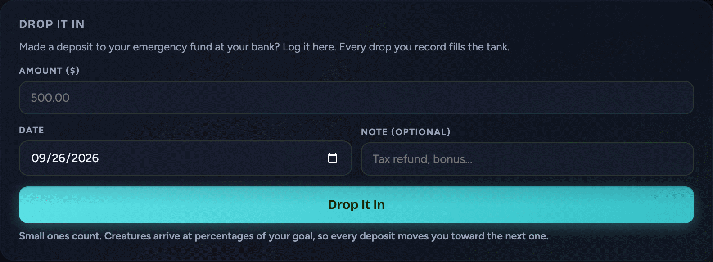
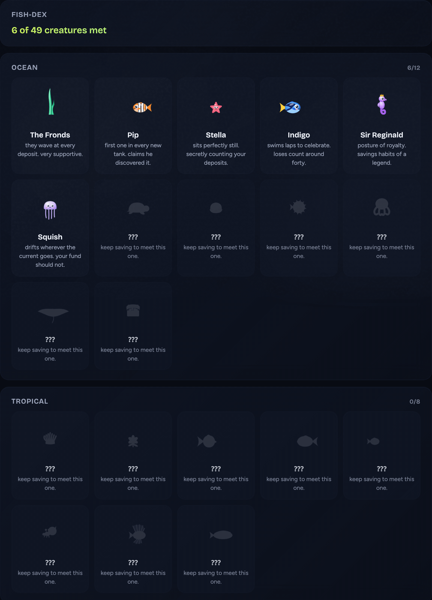

# Emergency Fund Aquarium 🐡

**A savings tracker where your emergency fund is a fish tank.** Set a goal, log what you put away, and watch the water rise. New creatures move in as you hit percentages of your goal, and Puff the pufferfish puffs up rounder with every deposit.

Don't want to host it yourself? Use the hosted version at **[emergencyfundaquarium.com](https://emergencyfundaquarium.com)**. It has a free plan, with no setup and no card. Or run your own copy with the code in this repo.


---

## What it does

| Tab | What you get |
|---|---|
| **Aquarium** | Your tank. The water level is your fund, and the creatures you've met swim in it. |
| **History** | Every deposit you've logged. Delete one and the water goes back down. |
| **Progress** | How far along you are and how it's been going. |
| **Fish-Dex** | All 49 creatures across six biomes. The ones you haven't met yet show as silhouettes until your fund reaches their percentage. |
| **Add Deposit** | The form. Amount, date and an optional note. |

It never connects to your bank and never holds money. You save at your own bank and log the deposits here. It also works on your phone and has a full how-to guide built in.

<p>


</p>

---

## Two ways to use it

### 1. Use the hosted version (easiest)

Go to **[emergencyfundaquarium.com](https://emergencyfundaquarium.com)** and sign up. The free plan has one active savings goal, unlimited deposits, the whole tank and the Fish-Dex, with the Ocean and Tropical biomes. Pro adds unlimited goals and four more biomes (Deep Sea, Lake, Coral Reef, Arctic). Paying for Pro there is also how you support the project.

### 2. Run your own copy

**What a copy gives you:** your copy runs the free plan for everyone. That's one active goal per account, unlimited deposits, the tank and the Fish-Dex, with Ocean and Tropical. You can raise the goal cap (see Free plan limit below). Pro isn't sold on a copy. The **Go Pro** button opens a short note that Pro is part of the hosted version at emergencyfundaquarium.com, with no price and no checkout.

Emergency Fund Aquarium runs on Cloudflare Workers with a D1 database. You'll need [Node.js](https://nodejs.org) 22 or newer. Trying it on your own computer needs no Cloudflare account. Putting it online needs one, and a free account is enough.

**Try it on your computer:**

```bash
git clone https://github.com/jensoltys/emergencyfundaquarium.git
cd emergencyfundaquarium
npm install
cp .dev.vars.example .dev.vars
```

Open the new `.dev.vars` file and put a long random string after `JWT_SECRET=` (32 or more characters). `openssl rand -hex 32` prints a good one. Until that's set, sign up and log in answer "This server isn't set up yet".

```bash
npm run db:setup:local
npm run dev
```

Open `http://localhost:8787`. With `DEV_LOG_CODES=true` in `.dev.vars`, the 6-digit signup code and any password reset link print in your terminal, so you can test without setting up email. That only works while `APP_URL` in `.dev.vars` is a localhost address. Running on a different port? Change `APP_URL` to match, because the printed reset link uses it.

**To put it online:**

Create your database, then paste the `database_id` it prints into `wrangler.toml`:

```bash
npx wrangler d1 create emergency-fund-aquarium
```

Set `APP_URL` and `FROM_EMAIL` in `wrangler.toml` to your live address and your sender, so the very first emails carry the right links. Then:

```bash
npm run db:setup:remote
npx wrangler secret put JWT_SECRET
npx wrangler secret put RESEND_API_KEY      # signup codes and password resets
npm run deploy                              # runs the security scan, then deploys
```

Use `npm run deploy`, not `npx wrangler deploy`. Only the npm script runs the security scan first.

### Settings

| Setting | Needed? | What it's for |
|---|---|---|
| `JWT_SECRET` | **Yes** | Signs logins. The app refuses to start a session without a 32+ character secret. |
| `APP_URL` | **Yes** | Your site's address. Links in emails point here, and so do the link-preview and canonical tags on every page. |
| `APP_NAME` | Optional | The app's name in alert and feedback webhook messages. Set in `wrangler.toml`. |
| `RESEND_API_KEY` + `FROM_EMAIL` | For a live site | Sends signup codes and password resets through [Resend](https://resend.com). If `FROM_EMAIL` is blank, emails go out from Resend's test sender, `onboarding@resend.dev`, which only delivers to the email on your own Resend account. Set it to an address on a domain you've verified in Resend. |
| `ALERT_WEBHOOK_URL` + `ALERT_TOKEN` | Optional | Get a message when the server hits an error. |
| `SIGNUP_WEBHOOK_URL` + `SIGNUP_WEBHOOK_SECRET` | Optional | Get a message on each new signup. |
| `FEEDBACK_WEBHOOK_URL` | Optional | Where the in-app feedback button sends messages. Blank hides the Feedback button. |

**Pro biomes stay locked on a copy.** Pro is part of the hosted version, so Deep Sea, Lake, Coral Reef and Arctic show the Go Pro note for everyone. The one function that decides who has Pro is `hasProAccess` in `src/worker.js`.

**Free plan limit** is `FREE_GOALS` near the top of `src/worker.js`. It starts at 1 active goal per account. Change it however you like on your own copy, then deploy again. The app's own screens still show the Go Pro note when someone tries to add a second goal, so if you raise the cap, also change the `goals.length >= 1` check in `public/app.js`.

### Before you run it publicly

Replace these before you go public:

- [ ] `YOUR COMPANY NAME`, `YOUR BUSINESS ADDRESS` and the contact emails in `public/legal/`, the page footers, the About &amp; data box in `public/index.html`, `EMAIL_SENDER_LINE` in `src/worker.js` (it goes at the bottom of every email), and `data_controller` and `contact` in the data export, also in `src/worker.js`.
- [ ] `YOUR STATE` and `YOUR COUNTY` in `public/legal/terms.html` (governing law and courts).
- [ ] The source code link in the footers and in `public/legal/terms.html`, if you run a changed version (the AGPL asks you to offer your own code).
- [ ] The lines in `public/legal/` that depend on your setup: Cloudflare Web Analytics, the feedback webhook and affiliate links in `privacy.html` and `do-not-sell.html`, and the line marked `EDIT THIS LINE` in `accessibility.html`.
- [ ] Section 4 of `public/legal/terms.html` (Paid plans). It says your site has no paid plan and takes no payments. Rewrite it if you add one.
- [ ] `YOUR-DOMAIN` in `public/robots.txt` (uncomment the Sitemap line once you have one).
- [ ] `public/.well-known/security.txt`: the `security@example.com` contact, the `example.com` address and the `Expires` date.
- [ ] `public/og.png`, the social share image. It shows emergencyfundaquarium.com. The tags that point to it use your `APP_URL`, so you only swap the picture.

The app also shows a daily tip card. Most tips link to other apps and posts by Jen Built It, the app's maker, and two are labeled affiliate links (Logie and Levanta). They're all in the `GENERAL_NUDGES` and `MILESTONE_NUDGES` lists in `public/app.js`. Swap in your own or empty the lists.

### Keep your copy as safe as emergencyfundaquarium.com

Your copy is built from the same source as emergencyfundaquarium.com, with the hosted site's own hookups turned into optional settings. So it gets the same protections. Passwords are hashed. Five wrong passwords lock out the network that made them for 15 minutes. Twenty wrong tries from all networks together pause that account's logins for 15 minutes, and Forgot password gets the owner back in right away. Signup codes allow 8 guesses a minute. A network that misses 5 times waits 30 minutes, and 20 misses end its day. A password change signs out every other session. One used reset link ends all of them. Signup, resend and reset answer in the same time whether or not an address has an account. Requests from other websites are blocked. Logging out clears the session on that device, and changing the password signs out every device. A few of those depend on your setup:

- [ ] **Use a long random `JWT_SECRET`.** The app won't log anyone in without one of 32+ characters. `openssl rand -hex 32` makes a good one.
- [ ] **Set up email before going live** (`RESEND_API_KEY` and `FROM_EMAIL`). `DEV_LOG_CODES` only works while `APP_URL` is a localhost address, so leave it out of a live site.
- [ ] **Keep secrets out of git.** Store them with `npx wrangler secret put`, never in `wrangler.toml`. `.dev.vars` is already ignored.
- [ ] **Stay updated.** Security fixes made on emergencyfundaquarium.com get copied here. Click **Watch** at the top of this page to hear about them, then pull and redeploy.

Found a security problem? See [SECURITY.md](SECURITY.md).

---

## Built with

Emergency Fund Aquarium is a Cloudflare Worker with a D1 database and a job that runs once a day. It uses Resend for signup codes and password resets, and the tests run on Node's built-in test runner.

## Tests

```bash
npm test                # unit tests, including parallel-request rate limit checks
npm run test:security   # scans for common security mistakes
```

## Made by

**Jen Soltys**. I build small apps that fix everyday annoyances at **[Jen Built It](https://jenbuiltit.com)** and write about building with AI at **[jen8n.com](https://jen8n.com)**.

If Emergency Fund Aquarium helps you, the best support is a **[Pro plan on emergencyfundaquarium.com](https://emergencyfundaquarium.com)** or a ⭐ on this repo.

## Contributing

Bug reports and ideas are welcome in [Issues](../../issues). I'm not taking pull requests right now, which keeps the commercial license option possible. You're free to fork it and make it yours under the license below. See [CONTRIBUTING.md](CONTRIBUTING.md) and the [code of conduct](CODE_OF_CONDUCT.md).

**Getting help:** self-hosted copies are community-supported. You run your copy, so you handle its setup, updates, backups and security. [SUPPORT.md](SUPPORT.md) says where to ask.

## License

[AGPL-3.0](LICENSE). You can use, change and share Emergency Fund Aquarium. If you run a changed version as a website for other people, you have to share your changed code under the same license.

### Commercial license

Want to build Emergency Fund Aquarium into a product without sharing your code, or run a changed version for customers without publishing your changes? You can buy a commercial license that replaces the AGPL terms for your business. Email **hello@jenbuiltit.com** with what you're building.

Emergency Fund Aquarium isn't a bank and doesn't give financial advice. Logie and Levanta are trademarks of their respective owners.

## Trademarks

The license covers the code, not the name. "Emergency Fund Aquarium", its logo, Puff the pufferfish and its look aren't licensed for your own product. If you run a changed copy for other people, give it your own name and branding. Saying it's "powered by Emergency Fund Aquarium" is fine. Don't present your copy as the original or as run or endorsed by Jen Built It.
